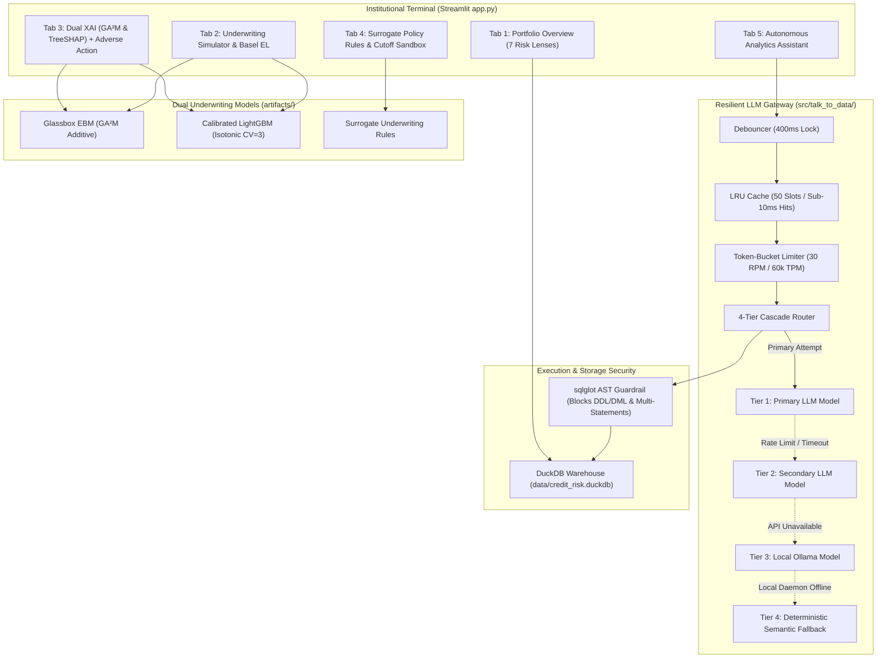

# CreditLens — AI-Powered Credit Risk Intelligence Platform

> **Intelligence. Innovation. Impact.**  
> A generic, company-agnostic proof-of-concept for AI/ML-driven credit underwriting, explainable AI, and autonomous data exploration.

---

## 1. Executive Summary

In consumer banking and commercial underwriting, machine learning platforms face a fundamental regulatory dilemma: **predictive accuracy versus explainability**. High-capacity gradient boosting models achieve superior risk discrimination, but their black-box nature creates strict compliance barriers under the **Fair Credit Reporting Act (FCRA, 15 U.S.C. § 1681m)** and **Equal Credit Opportunity Act (ECOA, 12 C.F.R. § 1002.9 - Regulation B)**.

**CreditLens** solves this by unifying:
1. **Dual Machine Learning Underwriting**: A Glassbox **Explainable Boosting Machine (EBM / $GA^2M$)** providing mathematically exact additive scorecards side-by-side with an isotonically calibrated **LightGBM** model.
2. **Automated Regulatory Adverse Action Engine**: Translates algorithmic log-odds and TreeSHAP negative attributions directly into compliant **FCRA / ECOA Form C-1** denial notices.
3. **ML-Derived Credit Underwriting Rules**: Transparent If-Then policy rules extracted from surrogate decision trees with empirical Support, Confidence, and Risk Lift metrics.
4. **Autonomous Talk-to-Data Assistant**: Natural language to SQL query engine backed by an in-process **DuckDB** analytical warehouse, protected by an **AST security guardrail**, **token-bucket rate limiter**, **UI debouncer**, and a **4-tier LLM fallback cascade**.
5. **Progressive Disclosure UI**: An institutional, zero-emoji banking terminal built for underwriters and credit committees, presenting actionable signals first and technical telemetry on demand.

---

### Quick Start (Under 60 Seconds)

#### Option A: Single-Command Docker Deployment (Recommended)

```zsh
# 1. Clone repository
git clone https://github.com/<your-username>/creditlens.git
cd creditlens

# 2. (Optional) Provide LLM API key for live inference
cp .env.example .env
# Edit .env to add your API key if desired

# 3. Launch the containerized platform
docker compose up --build
```

Access the application at: **`http://localhost:8501`**

*(Note: If no API key is provided, the platform automatically activates the deterministic fallback tier, guaranteeing all benchmark inquiries run flawlessly with 0 network dependencies.)*

#### Option B: Local Python Development
```zsh
# 1. Activate your virtual environment (Python 3.11+)
source .venv/bin/activate

# 2. Install dependencies
pip install -r requirements.txt

# 3. Run full automated test suite
pytest tests/ -v

# 4. Launch Streamlit interface
streamlit run app.py
```

---

## 2. End-to-End System Architecture



---

## 3. Automated Test Suite

The platform includes 44 unit and integration tests covering the complete AI engineering stack:

```zsh
pytest tests/ -v
```

```
tests/test_rate_limiter.py::test_rate_limiter_acquisition PASSED
tests/test_rate_limiter.py::test_rate_limiter_headroom_structure PASSED
tests/test_rate_limiter.py::test_rate_limiter_retry_helper PASSED
tests/test_rules.py::test_load_surrogate_rules PASSED
tests/test_rules.py::test_evaluate_applicant_high_risk PASSED
tests/test_sql_guardrail.py::test_valid_select_queries PASSED
tests/test_sql_guardrail.py::test_blocked_dml_ddl_queries PASSED
tests/test_talk_to_data.py::test_deterministic_matcher_all_5_benchmarks PASSED
tests/test_xai.py::test_ebm_local_explanation_exactness PASSED
tests/test_xai.py::test_generate_adverse_action_notice PASSED
...
======================= 44 passed in 3.45s =======================
```

---

## 4. Git Repository Management

To push this repository to GitHub:

```zsh
# 1. Verify you are on the main branch
git branch
# * main

# 2. Add remote origin repository
git remote add origin https://github.com/<your-username>/<your-repo-name>.git

# 3. Push to main branch
git push -u origin main
```

*(Note: `.gitignore` strictly prevents `.env`, test caches, and OS metadata from being pushed, keeping your remote repository clean and secure).*